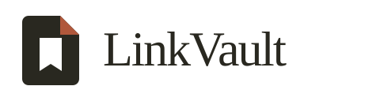

# LinkVault

<picture>
  <source media="(prefers-color-scheme: dark)" srcset="brand/wordmark-dark.png">
  
</picture>

Give ‘read later’ a home.

The [identity guide](brand/IDENTITY.md) includes the folded-page mark, light/dark wordmarks, palette, and reusable [launch artwork](brand/launch-card.png).

Your friends send you useful links. You promise to read them. LinkVault gives those promises a reading list.

Pre-release: local browser installation only. No browser-store release has been published from this checkout.

## Browser extension

Start with the [installation and browser table](extension/README.md#release-status-and-browsers). Chrome/Chromium is the current target. Edge, Brave, and Opera are manual-test targets, not verified support claims. Firefox requires a separate port and package.

The extension now has independent topic/site filters, reports, a first-open walkthrough, and a sun/moon theme toggle. See the [manual release checklist](docs/RELEASING.md), [privacy details](PRIVACY.md), and [contribution guide](CONTRIBUTING.md).

LinkedIn prohibits scraping and automation extensions. Both live collection modes carry account risk; manual scrolling and delays do not make them ban-proof. File import does not interact with LinkedIn. Read the [risk explanation](extension/README.md#choose-a-collection-method) before live collection. LinkVault is not affiliated with LinkedIn.

The [extension](extension/README.md) combines links across chats with subject/site filters, reading states, archiving, deletion with undo, file import, optional title fetching, and Markdown export. Live collection offers manual and automatic modes with account-risk warnings. Full JSON backups move your library between compatible profiles without an account. Python is not required. Use exported Markdown with your own AI tool separately if you want; there is no built-in model integration.

You and a friend share hundreds of article links on LinkedIn, WhatsApp, Telegram. LinkedIn's [official data export](https://www.linkedin.com/help/linkedin/answer/a1339364/down-your-account-data) includes sent, received, and archived messages. This project's current import flow uses saved chat HTML; LinkedIn archive ZIP/CSV import is not implemented yet. The Python tool extracts links, resolves `lnkd.in` short links, fetches titles, labels by topic (`db`, `os-linux`, `system-design`, ...), and writes a `collection.md` plus optional Obsidian notes.

Stdlib only. No dependencies. Python 3.10+.

## How it works

The sections below describe the original Python tool, not the browser reading library. WhatsApp and Telegram-specific extraction is unverified; generic HTML extraction does not establish full support.

```
chat thread (browser, logged in)
  -> browser/save-html.js saves linkedin-chat.html
  -> linkvault full linkedin-chat.html --out out --obsidian vault-notes
  -> out/collection.md + vault-notes/<topic>.md + link-collection-moc.md
```

Key trick: `lnkd.in` links serve a guard page. The real URL lives in the anchor with `data-tracking-control-name="external_url_click"`. LinkVault parses that, no login needed for resolution.

## Install

```bash
pip install -e .
linkvault full --help
```

No install needed too:

```bash
PYTHONPATH=src python -m linkvault.cli full linkedin-chat.html --out out
```

## Capture the HTML

See `browser/README.md`. Short version:

1. Open the thread, scroll up (PageUp) until history is loaded. Or paste `browser/scroll-loader.js` in DevTools Console for auto scroll.
2. Paste `browser/save-html.js` to download `linkedin-chat.html`.

## Run

```bash
linkvault full linkedin-chat.html --out out --obsidian vault-notes
```

Output:

- `out/collection.md`: all links grouped by topic.
- `vault-notes/`: one file per topic (`db.md`, `system-design.md`, ...) in Obsidian Full Note format plus `link-collection-moc.md` index.

Tune workers on slow networks:

```bash
linkvault full chat.html --out out --workers 10 --timeout 20
```

## Topics

Default labels: `dsa-interview`, `system-design`, `db`, `os-linux`, `network`, `docker-k8s-devops`, `backend`, `frontend-js`, `python`, `java`, `go`, `ai-ml`, `security`, `career-jobs`, `courses`, `videos`, `github-repos`, `articles`, `linkedin-posts`, `misc-useful`. Edit `src/linkvault/categorize.py` to add keywords.

## Tests

```bash
PYTHONPATH=src python -m pytest -q
```

## License

MIT.
